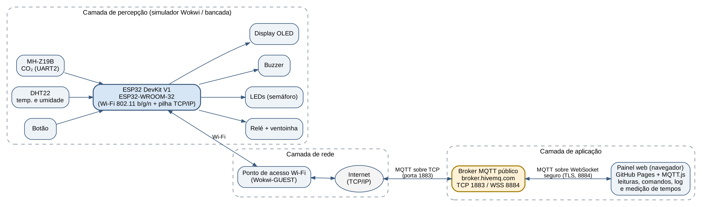
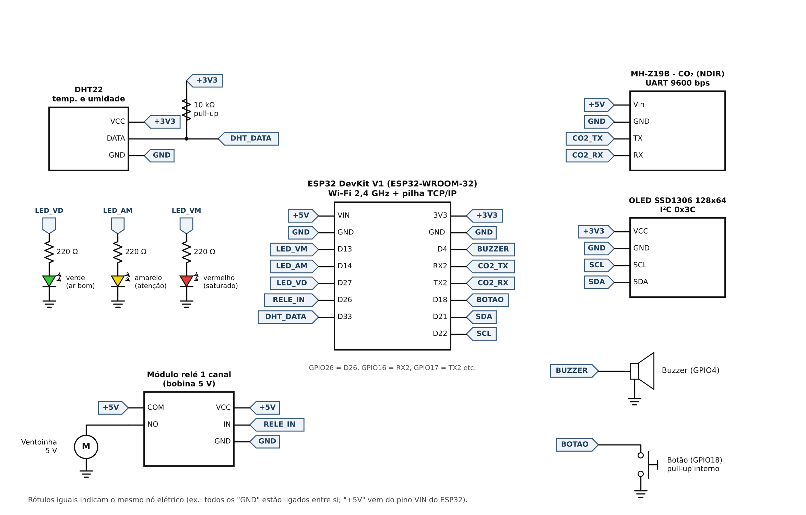

# Monitor de qualidade do ar interno com ESP32 e MQTT

Protótipo de Internet das Coisas que mede o **CO₂**, a **temperatura** e a **umidade** de um ambiente fechado, **liga a ventilação sozinho** quando o ar fica saturado, avisa quem está no cômodo com **LEDs, buzzer e display** e troca dados e comandos **pela internet com o protocolo MQTT**.

Projeto da disciplina **Objetos Inteligentes Conectados** do curso de Análise e Desenvolvimento de Sistemas da Universidade Presbiteriana Mackenzie, alinhado ao **ODS 3 (Saúde e Bem-Estar)**.

Autora: **Jennifer Herschel Maia** · Professor tutor: André Luis de Oliveira



## Links

| O quê | Onde |
|---|---|
| Painel web (MQTT pelo navegador) | https://jennifer-herschel.github.io/monitor-qualidade-ar-iot/painel/ |
| Simulação no Wokwi | https://wokwi.com/projects/481884192573757441 |
| Vídeo de demonstração | _link adicionado após a publicação do vídeo_ |

## Como funciona

1. O **ESP32** lê o sensor de CO₂ **MH-Z19B** (UART, protocolo de 9 bytes) e o **DHT22** (temperatura e umidade).
2. Classifica o ar em quatro níveis, usando como referência a **ABNT NBR 17037** (CO₂ interno até 700 ppm acima do externo):

   | Nível | CO₂ (referência externa de 420 ppm) | Resposta |
   |---|---|---|
   | Ar bom | até 820 ppm | LED verde; ventilação desligada no automático |
   | Atenção | 821 a 1.120 ppm | LED amarelo |
   | Ar saturado | acima de 1.120 ppm | LED vermelho; relé liga a ventilação após 15 s; alerta MQTT |
   | Alarme | acima de 1.520 ppm | buzzer intermitente até ser silenciado |

3. Aciona os **atuadores**: relé + ventoinha, LEDs (semáforo), buzzer e display OLED.
4. Publica as medições no **broker MQTT** (`broker.hivemq.com`, TCP 1883) e obedece aos comandos do **painel web**, que conecta ao mesmo broker por WebSocket seguro (porta 8884).

A decisão de ventilar é tomada na própria placa: sem internet, o controle local continua funcionando.

## Estrutura do repositório

```
firmware/monitor_ar/monitor_ar.ino   firmware do ESP32 (Arduino / C++)
wokwi/diagram.json                   montagem no simulador Wokwi
wokwi/libraries.txt                  bibliotecas usadas
wokwi/mhz19b.chip.c / .chip.json     emulação do sensor MH-Z19B no Wokwi
painel/index.html                    painel web MQTT (publicado no GitHub Pages)
docs/hardware.md                     hardware, pinagem, alimentação e montagem
docs/protocolos-e-interfaces.md      MQTT, tópicos, mensagens JSON, UART, I2C
docs/firmware.md                     documentação do código
docs/medicao-de-tempos.md            método de medição dos tempos de resposta
docs/imagens/                        diagramas
resultados/                          medições e capturas de tela
```

## Como reproduzir

### Opção 1: no simulador Wokwi (sem hardware)

0. Mais rápido: abra o projeto pronto em https://wokwi.com/projects/481884192573757441 e pule para o passo 5. Ou monte do zero:
1. Acesse https://wokwi.com/projects/new/esp32 (faça login para poder salvar).
2. Substitua o conteúdo de `sketch.ino` pelo arquivo `firmware/monitor_ar/monitor_ar.ino`.
3. Substitua o conteúdo de `diagram.json` pelo arquivo `wokwi/diagram.json`.
4. No menu de arquivos (seta ao lado das abas), crie os arquivos `libraries.txt`, `mhz19b.chip.json` e `mhz19b.chip.c` e cole o conteúdo dos arquivos da pasta `wokwi/`.
5. Clique em **Start the simulation**. O display mostra o aquecimento do sensor (10 s) e depois as leituras.
6. Abra o [painel web](https://jennifer-herschel.github.io/monitor-qualidade-ar-iot/painel/). Ele conecta sozinho ao broker e mostra o dispositivo como **online**.
7. Clique no sensor **MH-Z19B** no simulador e arraste o controle de CO₂ para cima de 1.120 ppm: o LED vermelho acende e, depois de 15 s, o relé liga a ventoinha (LED azul).
8. Use os botões do painel para ligar e desligar a ventilação, testar o buzzer e os LEDs e mandar uma mensagem ao display.

### Opção 2: na placa física

1. Monte o circuito conforme [docs/hardware.md](docs/hardware.md) e o esquema abaixo.
2. Na Arduino IDE 2, instale o pacote **esp32** (Espressif) e as bibliotecas do arquivo `wokwi/libraries.txt`.
3. Abra `firmware/monitor_ar/monitor_ar.ino`, mude `#define SIMULACAO 1` para `0` e preencha `WIFI_SSID` e `WIFI_SENHA` com a sua rede.
4. Selecione a placa **ESP32 Dev Module** e grave.
5. Abra o painel web e acompanhe as medições.



## Hardware

| Componente | Ligação no ESP32 |
|---|---|
| MH-Z19B (CO₂) | Vin → VIN (5 V), GND, TX → GPIO16 (RX2), RX → GPIO17 (TX2) |
| DHT22 | VCC → 3V3, DATA → GPIO33 (pull-up 10 kΩ), GND |
| Módulo relé | VCC → VIN, IN → GPIO26, GND; COM → 5 V, NO → ventoinha |
| LEDs verde / amarelo / vermelho | GPIO27 / GPIO14 / GPIO13 (220 Ω) |
| Buzzer | GPIO4 |
| OLED SSD1306 (I²C 0x3C) | SDA → GPIO21, SCL → GPIO22, 3V3, GND |
| Botão | GPIO18 → GND (pull-up interno) |

Detalhes em [docs/hardware.md](docs/hardware.md).

## Comunicação MQTT

Prefixo dos tópicos: `mackenzie/jhm10720667/ar`

| Tópico | Sentido | Exemplo |
|---|---|---|
| `.../medicao` | ESP32 → painel | `{"seq":42,"co2":1180,"temp":24.5,"umid":55.0,"nivel":"SATURADO","rele":"ON","modo":"AUTO","t_co2":210345,"t_dht":210351,"ms":210352}` |
| `.../ventilacao/comando` | painel → ESP32 | `{"cmd":"ON","id":"rele-17"}` (ou `OFF`, `AUTO`) |
| `.../ventilacao/estado` (retida) | ESP32 → painel | `{"rele":"ON","modo":"MANUAL","origem":"COMANDO","id":"rele-17","ms":215002}` |
| `.../alarme/comando` | painel → ESP32 | `{"cmd":"TESTE"}` ou `{"cmd":"SILENCIAR"}` |
| `.../leds/comando` | painel → ESP32 | `{"cmd":"TESTE"}` |
| `.../display/comando` | painel → ESP32 | `{"cmd":"MSG","texto":"Abra a janela!"}` |
| `.../config` (retida) | painel → ESP32 | `{"ref":420,"persist_s":15,"min_s":30,"intervalo_s":5}` |
| `.../alerta` | ESP32 → painel | `{"tipo":"NIVEL","detalhe":"SATURADO","co2":1180}` |
| `.../status` (retida, testamento) | ESP32 → todos | `online` / `offline` |
| `.../ping` → `.../pong` | ambos | alinhamento de relógio para medir tempos |

Detalhes em [docs/protocolos-e-interfaces.md](docs/protocolos-e-interfaces.md).

> O broker público não tem autenticação e serve apenas para demonstração. Para uso real, use um broker próprio com usuário, senha e TLS.

## Licença

MIT. Veja [LICENSE](LICENSE).
