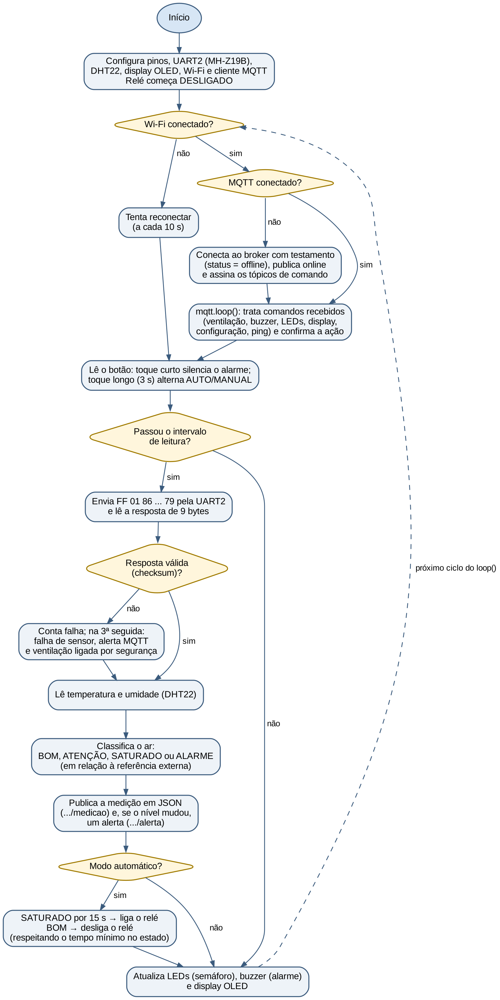

# Documentação do firmware

Arquivo: [`firmware/monitor_ar/monitor_ar.ino`](../firmware/monitor_ar/monitor_ar.ino) (C++ / Arduino, ESP32).

## Bibliotecas

| Biblioteca | Uso |
|---|---|
| WiFi (arduino-esp32) | conexão Wi-Fi |
| PubSubClient (Nick O'Leary) | cliente MQTT 3.1.1 |
| ArduinoJson 7 (Benoît Blanchon) | montar e ler JSON |
| DHT sensor library for ESPx / DHTesp (beegee-tokyo) | leitura do DHT22 |
| Adafruit GFX + Adafruit SSD1306 | display OLED |

## Configuração (seção 1 do código)

| Constante | Padrão | Significado |
|---|---|---|
| `SIMULACAO` | 1 | 1 = Wokwi (aquecimento 10 s, leitura 5 s, persistência 15 s, tempo mínimo 30 s); 0 = placa (180 s, 10 s, 60 s, 300 s) |
| `WIFI_SSID` / `WIFI_SENHA` | `Wokwi-GUEST` / vazio | rede Wi-Fi |
| `MQTT_HOST` / `MQTT_PORTA` | `broker.hivemq.com` / 1883 | broker |
| `TOPICO_BASE` | `mackenzie/jhm10720667/ar` | prefixo de todos os tópicos |
| `cfg.refExterna` | 420 ppm | CO₂ do ar externo (alterável por MQTT) |

## Funções

| Função | Descrição |
|---|---|
| `setup()` | configura pinos (relé começa desligado), UART2, desliga a autocalibração do MH-Z19B, DHT22, OLED, Wi-Fi e cliente MQTT (buffer 512 B, keep-alive 15 s) |
| `loop()` | `manterConexao()`, `mqtt.loop()`, `lerBotao()`, ciclo de medição no intervalo, republicação do estado a cada 60 s, LEDs, buzzer e tela |
| `checksumMHZ()` | checksum do protocolo do MH-Z19B |
| `lerCO2()` | envia o pedido 0x86, espera até 200 ms pela resposta, valida e devolve ppm (ou −1) |
| `configurarABC()` | liga/desliga a autocalibração do sensor (comando 0x79) |
| `classificar()` | converte ppm em BOM, ATENCAO, SATURADO ou ALARME |
| `cicloDeMedicao()` | lê sensores, conta falhas (3 seguidas = falha de sensor), classifica, publica medição e alertas |
| `controleAutomatico()` | histerese: liga em SATURADO por `persistMs`, desliga em BOM, respeitando `minEstadoMs`; em falha de sensor liga por segurança |
| `acionarRele()` | escreve no GPIO26, registra `millis()` da ação e publica `/ventilacao/estado` (retida) com `id` e `ms` |
| `atualizarLEDs()` | semáforo; pisca amarelo no aquecimento e vermelho em falha |
| `atualizarBuzzer()` | alarme intermitente (500 ms) no nível ALARME, salvo se silenciado |
| `atualizarTela()` | CO₂, temperatura, umidade, nível, ventilação, Wi-Fi/MQTT ou mensagem do painel |
| `publicarJSON()` | serializa e publica (QoS 0, retida opcional) |
| `publicarConfig()` | publica `/config/atual` (retida) |
| `confirmarAcao()` | publica a confirmação de um atuador com `id` e `ms` |
| `aoReceberMensagem()` | trata ping, ventilação, alarme, LEDs, display e configuração |
| `manterConexao()` | reconecta Wi-Fi/MQTT a cada 10 s, com testamento `offline` retido em `/status` |
| `lerBotao()` | toque curto silencia o alarme por 15 min; toque de 3 s alterna AUTO/MANUAL |

## Comportamento em falhas

- Ao ligar: relé desligado, LED amarelo piscando durante o aquecimento do sensor.
- MH-Z19B sem resposta válida 3 vezes: alerta `FALHA_SENSOR`, LED vermelho piscando e ventilação ligada (modo automático).
- Wi-Fi ou broker fora: medição e controle local continuam; reconexão a cada 10 s.
- Placa some da rede: o broker publica `offline` em `/status` (testamento).

## Emulação do MH-Z19B no Wokwi

[`wokwi/mhz19b.chip.c`](../wokwi/mhz19b.chip.c) usa a API de chips customizados do Wokwi (`uart_init`, `uart_write`, `attr_init`). Ele espera o quadro de 9 bytes, confere o checksum e, para o comando 0x86, responde com a concentração do controle deslizante (com variação de ±5 ppm). Os comandos 0x79 e 0x87 são aceitos sem resposta.

## Painel web

[`painel/index.html`](../painel/index.html): HTML + JavaScript com MQTT.js (WebSocket seguro) e Chart.js. Mostra leituras, gráfico, alertas e o log das mensagens MQTT, envia comandos e faz a medição dos tempos de resposta (ver [medicao-de-tempos.md](medicao-de-tempos.md)).
