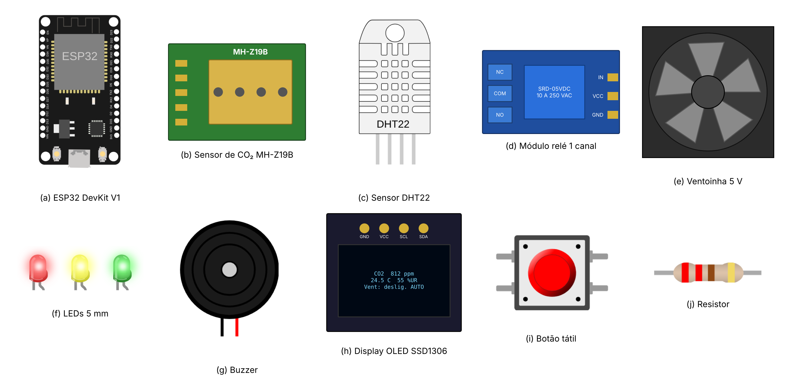
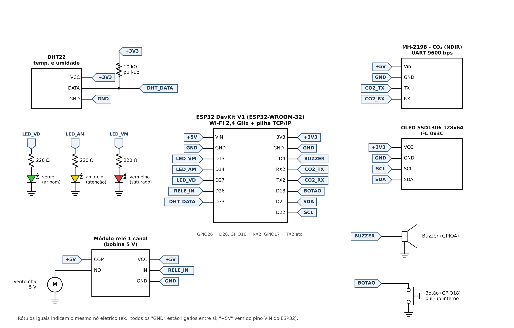

# Hardware

## Plataforma

**ESP32 DevKit V1** (módulo ESP32-WROOM-32): processador de dois núcleos até 240 MHz, 520 KB de SRAM, Wi-Fi 802.11 b/g/n e Bluetooth integrados, três UARTs, nível lógico de 3,3 V.

Motivo da escolha: o sensor de CO₂ conversa por porta serial. No ESP32 a UART0 fica livre para gravação e depuração e a UART2 (GPIO16/17) fica dedicada ao sensor. O Arduino Uno não tem rede e só tem uma UART; o NodeMCU (ESP8266) tem Wi-Fi, mas só uma UART completa e poucos pinos livres.

## Lista de materiais

| Qtd. | Componente | Especificação | Função |
|---|---|---|---|
| 1 | ESP32 DevKit V1 | ESP32-WROOM-32, 30 pinos | Controlador e módulo de comunicação (Wi-Fi + TCP/IP) |
| 1 | MH-Z19B | NDIR, 0 a 5.000 ppm, ±(50 ppm + 5%), 4,5 a 5,5 V, UART 3,3 V a 9.600 bps | Sensor de CO₂ |
| 1 | DHT22 (AM2302) | −40 a 80 °C (±0,5 °C), 0 a 100% UR (±2%), 1 fio | Sensor de temperatura e umidade |
| 1 | Resistor 10 kΩ | 1/4 W | Pull-up da linha de dados do DHT22 |
| 1 | Módulo relé 1 canal | Bobina 5 V, contato 10 A / 250 VCA | Liga a ventilação |
| 1 | Ventoinha 5 V | 0,2 A (no Wokwi: LED azul) | Ventilação de bancada |
| 3 | LEDs 5 mm | verde, amarelo, vermelho | Semáforo do ar |
| 4 | Resistores 220 Ω | 1/4 W | Limitam a corrente dos LEDs |
| 1 | Buzzer | 3,3 a 5 V | Alarme sonoro |
| 1 | Display OLED | 0,96", 128 x 64, SSD1306, I²C 0x3C | Mostra leituras e estados |
| 1 | Botão tátil | normalmente aberto | Silencia alarme / alterna modo |
| 1 | Fonte 5 V / 2 A, protoboard 830 pontos, jumpers | | Alimentação e montagem |

## Pinagem

| Componente | Pino do componente | ESP32 | Observação |
|---|---|---|---|
| MH-Z19B | Vin / GND | VIN (5 V) / GND | a lâmpada IR precisa de 5 V |
| MH-Z19B | TX / RX | GPIO16 (RX2) / GPIO17 (TX2) | cruzado: TX de um no RX do outro |
| DHT22 | VCC / DATA / GND | 3V3 / GPIO33 / GND | pull-up de 10 kΩ entre DATA e 3,3 V |
| Relé | VCC / IN / GND | VIN / GPIO26 / GND | COM ligado aos 5 V, NO no + da ventoinha |
| LED verde | anodo via 220 Ω | GPIO27 | ar bom |
| LED amarelo | anodo via 220 Ω | GPIO14 | atenção ou umidade fora de 40 a 60% |
| LED vermelho | anodo via 220 Ω | GPIO13 | ar saturado |
| Buzzer | + / − | GPIO4 / GND | |
| OLED | SDA / SCL / VCC / GND | GPIO21 / GPIO22 / 3V3 / GND | I²C |
| Botão | 1 / 2 | GPIO18 / GND | pull-up interno |

Os pinos de inicialização (strapping) GPIO0, GPIO2, GPIO12 e GPIO15 ficaram livres de propósito.

## Alimentação

O ESP32 recebe 5 V pela USB (ou fonte externa de 5 V / 2 A) e repassa esses 5 V pelo pino VIN para o MH-Z19B (pico de cerca de 150 mA), a bobina do relé e a ventoinha. O DHT22 e o display usam a saída de 3,3 V do regulador da placa.

## Montagem no Wokwi

O arquivo [`../wokwi/diagram.json`](../wokwi/diagram.json) reproduz a mesma pinagem. Duas adaptações:

- **MH-Z19B**: o Wokwi não tem esse sensor; ele é emulado pelo chip customizado [`mhz19b.chip.c`](../wokwi/mhz19b.chip.c), que responde ao protocolo serial real do sensor. A concentração é ajustada pelo controle deslizante do chip.
- **Ventoinha**: representada por um LED azul ligado ao contato NO do relé.

## Caixa e peças

Para a montagem física está prevista uma caixa plástica ventilada (furos laterais) de cerca de 120 x 80 x 50 mm, com o sensor de CO₂ e o DHT22 junto aos furos e longe do regulador do ESP32, para que o calor da placa não altere a leitura. O protótipo não usa peças impressas em 3D nesta versão.
