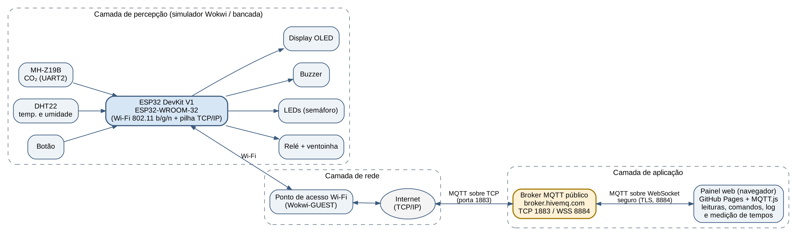
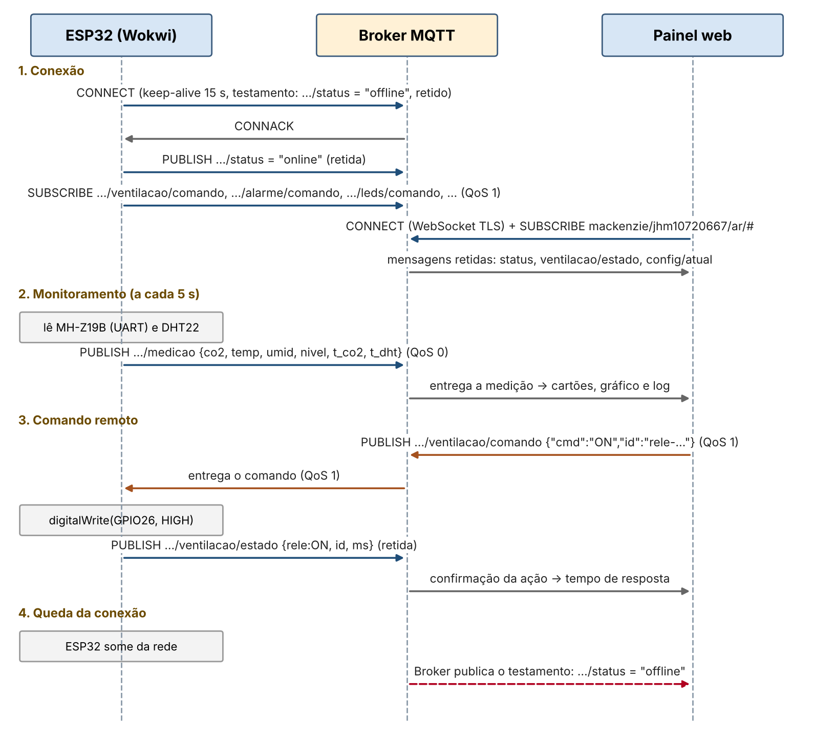

# Protocolos, interfaces e módulo de comunicação



## Visão geral das interfaces

| Interface | Entre | Detalhes |
|---|---|---|
| UART2 (serial) | ESP32 ↔ MH-Z19B | 9.600 bps, 8N1, quadros de 9 bytes |
| 1 fio (one-wire próprio) | ESP32 ↔ DHT22 | GPIO33, leitura a cada ciclo (mínimo 2 s) |
| I²C | ESP32 ↔ OLED SSD1306 | SDA GPIO21, SCL GPIO22, endereço 0x3C |
| GPIO digital | ESP32 → relé, LEDs, buzzer; botão → ESP32 | nível alto aciona; botão com pull-up interno |
| Wi-Fi 802.11 b/g/n | ESP32 ↔ ponto de acesso | no Wokwi: rede `Wokwi-GUEST`, sem senha, canal 6 |
| MQTT 3.1.1 sobre TCP | ESP32 ↔ broker | `broker.hivemq.com:1883` |
| MQTT sobre WebSocket seguro (TLS) | painel ↔ broker | `wss://broker.hivemq.com:8884/mqtt` |

## Módulo de comunicação

O módulo de comunicação é o próprio **ESP32-WROOM-32**, que integra o rádio Wi-Fi e a pilha TCP/IP. Não há placa de rede separada nem ponte serial com um computador. No firmware:

- `WiFi.begin(ssid, senha, canal)` conecta à rede (biblioteca WiFi do arduino-esp32);
- `PubSubClient` abre a conexão TCP com o broker e implementa o MQTT 3.1.1;
- a reconexão é feita a cada 10 s, sem bloquear o laço principal.

## Funções de conversão entre as interfaces

1. **UART → número**: pedido `FF 01 86 00 00 00 00 00 79`; resposta `FF 86 HH LL TT SS U1 U2 CS`.
   `CO2 (ppm) = HH * 256 + LL`. `CS = 0xFF - (soma dos bytes 1 a 7) + 1` (funções `lerCO2()` e `checksumMHZ()`).
2. **Números → JSON → MQTT**: `cicloDeMedicao()` monta o JSON com ArduinoJson e `publicarJSON()` publica.
3. **MQTT → JSON/texto → pino**: `aoReceberMensagem()` aceita `ON` ou `{"cmd":"ON","id":"x"}`, interpreta e chama `acionarRele()`, que faz o `digitalWrite()` e publica a confirmação.

## Tópicos MQTT

Prefixo: `mackenzie/jhm10720667/ar` (exclusivo, porque o broker é público).

| Tópico | Publica | Assina | QoS | Retida | Conteúdo |
|---|---|---|---|---|---|
| `/medicao` | ESP32 | painel | 0 | não | medição em JSON a cada 5 s (simulação) |
| `/ventilacao/comando` | painel | ESP32 | 1 | não | `ON`, `OFF`, `AUTO` |
| `/ventilacao/estado` | ESP32 | painel | 0 | sim | relé, modo, origem, id, instante da ação |
| `/alarme/comando` | painel | ESP32 | 1 | não | `TESTE`, `SILENCIAR` |
| `/alarme/estado` | ESP32 | painel | 0 | não | confirmação do buzzer |
| `/leds/comando` | painel | ESP32 | 1 | não | `TESTE` (acende os três LEDs por 1,5 s) |
| `/leds/estado` | ESP32 | painel | 0 | não | confirmação |
| `/display/comando` | painel | ESP32 | 1 | não | `{"cmd":"MSG","texto":"..."}` (até 20 caracteres, 3 s na tela) |
| `/display/estado` | ESP32 | painel | 0 | não | confirmação |
| `/config` | painel | ESP32 | 1 | sim | `ref`, `persist_s`, `min_s`, `intervalo_s` |
| `/config/atual` | ESP32 | painel | 0 | sim | configuração em uso e limites calculados |
| `/alerta` | ESP32 | painel | 0 | não | mudança de nível, falha de sensor |
| `/status` | ESP32 (testamento) | painel | 1 | sim | `online` / `offline` |
| `/ping` | painel | ESP32 | 0 | não | `{"cmd":"PING","id":"..."}` |
| `/pong` | ESP32 | painel | 0 | não | `{"id":"...","ms":<millis do ESP32>}` |

A biblioteca PubSubClient só **publica** com QoS 0, mas **assina** com QoS 1. Por isso os comandos são publicados pelo painel com QoS 1, e cada ação é confirmada pelo ESP32 com o mesmo `id` do comando.

## Formato das mensagens

Medição:

```json
{"seq":42,"co2":1180,"temp":24.5,"umid":55.0,"nivel":"SATURADO","rele":"ON","modo":"AUTO",
 "t_co2":210345,"t_dht":210351,"ms":210352}
```

- `t_co2` e `t_dht`: `millis()` do ESP32 no instante em que cada sensor foi lido;
- `ms`: instante do envio.

Estado da ventilação:

```json
{"rele":"ON","modo":"MANUAL","origem":"COMANDO","id":"rele-1732070000000-3","ms":215002}
```

`origem`: `AUTO`, `COMANDO`, `BOTAO`, `FALHA`, `INICIO` ou `PERIODICO`.

## Sequência de mensagens



## Testando sem o painel

Qualquer cliente MQTT serve. Exemplo com o cliente web da HiveMQ (https://www.hivemq.com/demos/websocket-client/) ou com o `mosquitto_pub`/`mosquitto_sub`:

```bash
mosquitto_sub -h broker.hivemq.com -t 'mackenzie/jhm10720667/ar/#' -v
mosquitto_pub -h broker.hivemq.com -t 'mackenzie/jhm10720667/ar/ventilacao/comando' -q 1 -m 'ON'
```
